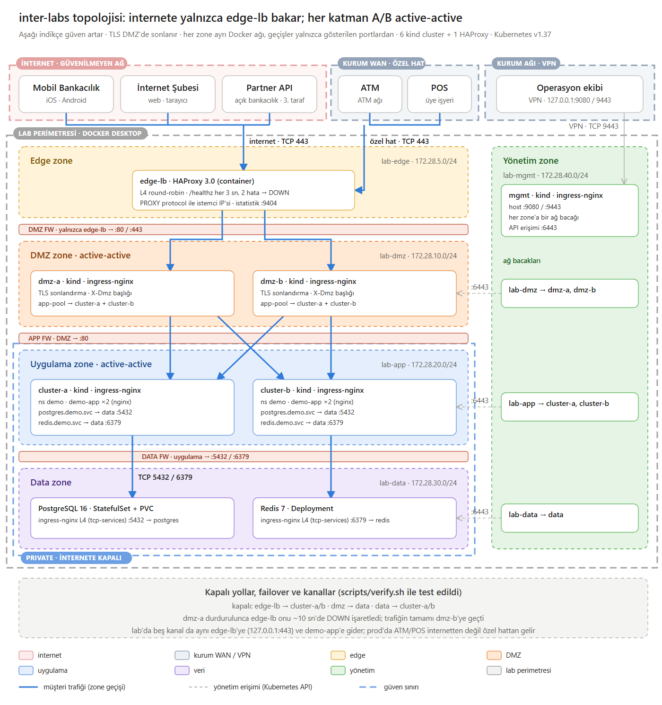
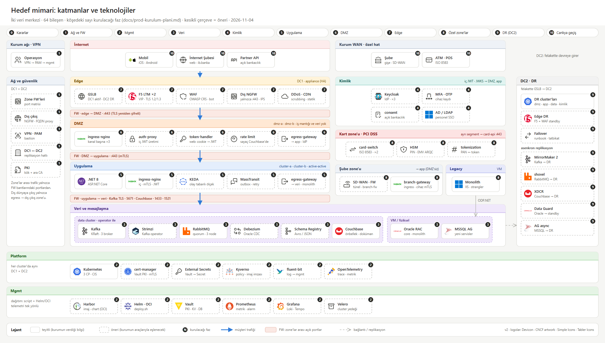

# inter-labs — Prod benzeri multi-cluster Kubernetes demo ortamı

Prod topolojisinin (Edge LB, DMZ A/B, Cluster A/B, Data, Mgmt) lokal kopyası. Edge LB bir
HAProxy container'ı; diğer her biri ayrı bir [kind](https://kind.sigs.k8s.io/) cluster'ı ve
her cluster'ın girişi **ingress-nginx**.

```
                    İnternet (host: 127.0.0.1:80/443)
                                │
                  ┌─────────────▼─────────────┐
   lab-edge       │  edge-lb (HAProxy)        │  L4 round-robin + health check
                  │  :9404 istatistik sayfası │  PROXY protocol ile istemci IP'si
                  └──────┬──────────────┬─────┘
                         │              │
   lab-dmz        ┌──────▼──────┐ ┌─────▼───────┐
                  │ dmz-a       │ │ dmz-b       │  TLS sonlandırma, edge kuralları
                  │ ingress-ngx │ │ ingress-ngx │
                  └──────┬──────┘ └─────┬───────┘
                         │ round-robin  │  (app / app-a / app-b)
   lab-app        ┌──────▼──────┐ ┌─────▼───────┐
                  │ cluster-a   │ │ cluster-b   │  demo-app (2 replika)
                  │ ingress-ngx │ │ ingress-ngx │
                  └──────┬──────┘ └─────┬───────┘
                         │ TCP 5432/6379│
   lab-data       ┌──────▼──────────────▼─────┐
                  │  Data cluster             │  Postgres, Redis
                  │  ingress-nginx (L4/TCP)   │
                  └───────────────────────────┘

   lab-mgmt       ┌───────────────────────────┐
   (+ dmz/app/data)│  Mgmt cluster  :9443      │  yönetim araçları → tüm cluster API'leri
                  └───────────────────────────┘
```



Kaynak: [docs/images/src/topo_inter_labs.py](docs/images/src/topo_inter_labs.py) · Prod hedef mimarisi (iki DC, .NET, monolith, Kafka, RabbitMQ, Couchbase, Oracle, MSSQL): [docs/images/prod-detay](docs/images/prod-detay/README.md) · Lab ortamının ayrıntıları: [docs/images/lab-detay](docs/images/lab-detay/README.md) · Hepsi draw.io'da (her resim ayrı sekme): [docs/images/inter-labs.drawio](docs/images/inter-labs.drawio) · Prod kurulum proje planı: [docs/prod-kurulum-plani.md](docs/prod-kurulum-plani.md)

## Mimari genel bakış

Prod hedef mimarisinin katmanları ve her katmanda kullanılan teknolojiler (logolarıyla, kurulacağı
fazla birlikte): [docs/images/mimari](docs/images/mimari/README.md). Her faz bitiminde o fazın sonunu
gösteren yeni bir resim (`faz-NN-<faz>.png`) eklenir; eskiler değişmez.

[](docs/images/mimari/README.md)

## Prod kurulum planı

Prod hedef mimarisinin ([prod-detay](docs/images/prod-detay/README.md)) nasıl kurulacağı
[docs/prod-kurulum-plani.md](docs/prod-kurulum-plani.md) dosyasında: zone/cluster envanteri, kararlar,
11 faz (iş kalemleri + çıkış kriterleri), bağımlılıklar, riskler ve teslimatlar. Sıra içeriden
dışarıya; dağıtım mgmt'den script + Helm/OCI ile (bu lab'daki `up.sh` / `verify.sh` mantığının prod
sürümü).

| Faz | Kapsam | Sonra |
|---|---|---|
| 0 | Kararlar: ürün eşleme, K8s dağıtımı, IP/VLAN, PKI, DNS, kapasite, PCI kapsamı, RPO/RTO | 1 |
| 1 | Ağ ve FW: zone segmentleri, port matrisi, dış çıkış zone'u, VPN/PAM/bastion | 2 |
| 2 | Mgmt: registry, Vault, CI, `deploy.sh`, gözlem, yedek | 3, 4 |
| 3 | Veri: Oracle RAC, MSSQL AG, Kafka, RabbitMQ, Couchbase | 5 |
| 4 | Kimlik: IdP, MFA/OTP, consent, directory | 5 |
| 5 | Uygulama: cluster-a / cluster-b, platform, iç ingress, egress, .NET servisleri | 6, 8, 9 |
| 6 | DMZ: dmz-a / dmz-b, kanal ingress'leri, auth, ratelimit | 7 |
| 7 | Edge: F5, WAF, NGFW, DDoS/CDN, GSLB | 10 |
| 8 | Özel zone'lar: şube, kart (PCI), legacy monolith (strangler) | 10 |
| 9 | DR (DC2): DR cluster'ları, replikasyon, failover tatbikatı | 10 |
| 10 | Uçtan uca senaryolar, arıza/yük testi, pentest, PCI denetimi, kademeli canlıya geçiş | — |

## Gereksinimler

Docker Desktop, `kind`, `kubectl`, `helm`, `openssl`, `curl` (Windows'ta Git Bash ile çalışır).
Yaklaşık 7 GB RAM.

## Kullanım

```bash
bash scripts/up.sh       # kur (idempotent, yarıda kalırsa tekrar çalıştır)
bash scripts/verify.sh   # uçtan uca doğrula
bash scripts/down.sh     # hepsini sil
```

| Adres | Ne |
|---|---|
| https://app.localtest.me | edge LB → DMZ A/B → A/B (her katman active-active) |
| https://app-a.localtest.me / https://app-b.localtest.me | … → sadece cluster-a / sadece cluster-b |
| http://127.0.0.1:9404 | Edge LB (HAProxy) istatistik ve backend sağlık sayfası |
| https://*.localtest.me:9443 | Mgmt ingress'i (yönetim araçları için, şu an boş) |

`*.localtest.me` herkese açık DNS'te 127.0.0.1'e çözülür, hosts dosyası gerekmez.
Sertifika self-signed (`.certs/`), curl için `-k` kullanın.

kubectl context'leri: `kind-dmz-a`, `kind-dmz-b`, `kind-cluster-a`, `kind-cluster-b`, `kind-data`, `kind-mgmt`.

## Nasıl çalışır

**Network segmentasyonu.** Her zone ayrı bir docker bridge network'ü. Docker farklı
bridge'ler arasında trafiğe izin vermediği için bunlar firewall'lı segment gibi davranır.
Bir node'un başka bir zone'a erişmesi için o network'e ayrıca bağlanması gerekir:

| Cluster | Network'ler | Erişebildiği |
|---|---|---|
| edge-lb | lab-edge, lab-dmz | DMZ ingress |
| dmz-a / b | lab-dmz, lab-app | A/B ingress |
| cluster-a / b | lab-app, lab-data | data ingress |
| data | lab-data | — |
| mgmt | lab-mgmt, lab-dmz, lab-app, lab-data | tüm API server'lar |

**Edge LB.** `edge/haproxy.cfg.tpl`: 80/443'ü TCP seviyesinde dmz-a / dmz-b'ye dağıtır,
3 saniyede bir ingress'lerin `/healthz`'ini kontrol eder ve 2 başarısız kontrolde backend'i
çıkarır. TLS'e dokunmaz; istemci IP'sini PROXY protocol ile iletir (DMZ ingress'lerinde
`use-proxy-protocol: true`). DMZ cevaplarındaki `X-Dmz` başlığı hangi DMZ cluster'ından
geçildiğini gösterir. Failover denemesi:

```bash
docker pause dmz-a-control-plane     # ~6 sn sonra tüm trafik dmz-b'ye gider
docker unpause dmz-a-control-plane
```

**Cluster'lar arası yönlendirme.** Karşı cluster'ın ingress'i, yerel bir *selector'sız
Service* + elle yazılmış *EndpointSlice* ile temsil edilir (IP'ler `up.sh` tarafından
`docker inspect` ile bulunur):

- DMZ (her iki cluster'da da aynı) `edge/app-pool` → A ve B node'larının `:80`'i. Biri düşerse `proxy-next-upstream` diğerine geçer.
- A/B `demo/postgres`, `demo/redis` → data node'unun `:5432` / `:6379`'u; bu portları data
  cluster'ındaki ingress-nginx `tcp-services` ile Postgres/Redis'e iletir. Uygulamalar sadece
  `postgres.demo.svc` adresini bilir.

**İstemci IP'si.** DMZ ingress istemci IP'sini sadece edge LB'nin PROXY protocol başlığından
alır, gelen `X-Forwarded-For`'a güvenmez; app ingress'leri sadece
`lab-app` subnet'inden (DMZ) geleni kabul eder (`proxy-real-ip-cidr`). demo-app cevabındaki
`xff` alanında zinciri görebilirsiniz.

**Mgmt.** Yönetim araçları için ayrılmış cluster; tüm zone network'lerine bağlı olduğu için
her cluster'ın API server'ına (`<node-ip>:6443`) ulaşabilir. Şu an üzerinde sadece
ingress-nginx var; dağıtım `scripts/up.sh` ile yapılır.

## Dizin yapısı

```
config.env                 chart/imaj versiyonları, network'ler
edge/                      edge LB (HAProxy) yapılandırması
clusters/                  kind cluster tanımları (CIDR'lar, port mapping'ler)
platform/ingress-nginx/    ortak + zone bazlı ingress-nginx değerleri
workloads/dmz/             edge upstream servisleri ve ingress kuralları
workloads/app/             demo-app (base + cluster-a/b overlay'leri)
workloads/data/            Postgres, Redis
scripts/                   up / verify / down
docs/prod-kurulum-plani.md prod kurulum proje planı
docs/images/               topoloji, mimari, lab-detay ve prod-detay resimleri, draw.io dosyası
docs/images/logos/         mimari resimlerindeki teknoloji logoları (SVG)
```

## Prod'dan farkları / bilinen sınırlar

- Her cluster tek node'lu (RAM için). Worker eklemek için `clusters/*.yaml`'a `- role: worker`
  eklenebilir; ingress `ingress-ready=true` etiketli node'da kalır.
- Segmentasyon network (L3) seviyesinde; aynı segmentteki port bazlı kurallar (örn. DMZ'nin
  A/B'de sadece 80'e erişmesi) uygulanmıyor. DMZ'den mgmt'ye de erişim mümkün çünkü mgmt
  `lab-dmz`'ye bağlı.
- Docker Desktop yeniden başlarsa node IP'leri değişebilir; `up.sh`'yi tekrar çalıştırmak
  EndpointSlice'ları ve edge LB yapılandırmasını günceller.
- Edge LB tek bir container (prod'da genelde HA çift / F5 cluster'ı).
- ingress-nginx projesi Mart 2026 itibarıyla upstream'de emekliye ayrıldı (yeni güvenlik
  yaması yok). Demo için sorun değil; prod'da Gateway API tabanlı bir alternatife geçiş
  [kurulum planında](docs/prod-kurulum-plani.md#riskler-ve-açık-konular) risk olarak kayıtlı.
