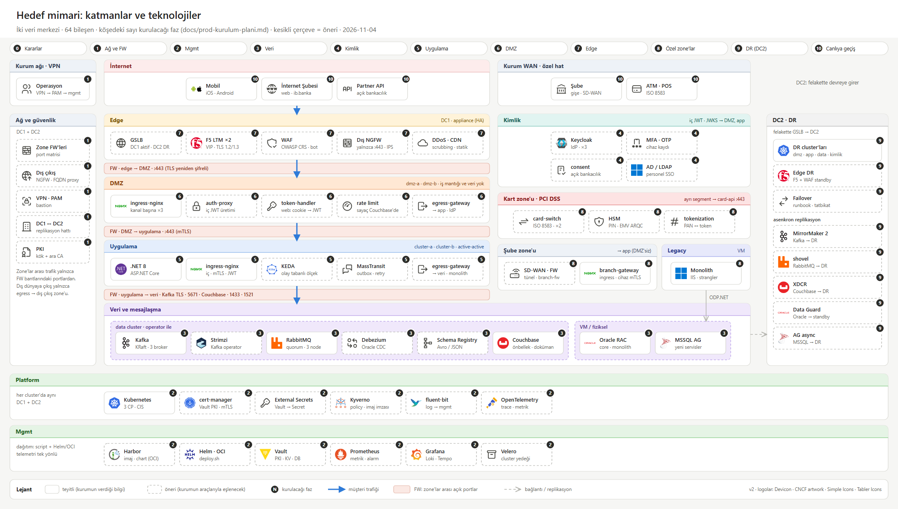

# Mimari genel bakış: katmanlar, teknolojiler, fazlar

Bu klasör prod hedef mimarisini tek resimde, referans mimari düzeninde gösterir:

- **Ortada istek yolu:** edge → DMZ → uygulama → veri. Zone'lar arasında FW bantları ve açık portlar bulunur.
- **Yanda:** kimlik, kart (PCI), şube ve legacy zone'ları.
- **Solda:** ağ ve güvenlik.
- **Sağda:** DC2 (DR) ve replikasyon.
- **Altta:** her cluster'da ortak olan platform katmanı ve mgmt.

Her kartta bileşenin logosu, adı ve [kurulum planında](../../prod-kurulum-plani.md) hangi fazda
kurulacağı yer alır. Bir faz bittiğinde **yeni bir resim** eklenir; eski resimler değiştirilmez. Böylece klasör,
kurulumun fazdan faza ilerleyişini kayıt altına alır.



## Dosyalar

| Dosya | Ne gösterir | Ne zaman üretilir |
|---|---|---|
| `00-hedef-mimari.png` | Hedef: tüm katmanlar ve bileşenler; her kartta faz, teyitli / öneri | Teknoloji listesi değişince yeniden üretilir |
| `faz-NN-<faz>.png` | Faz NN sonu: kurulan bileşenler yeşil "✓ kuruldu", diğerleri soluk "planlı" | Her faz bitiminde **bir kez**, yeni dosya olarak |

Faz dosyalarının adları kurulum planındaki fazları izler:

| Faz | Dosya | Durum |
|---|---|---|
| 0 | `faz-00-kararlar.png` | — |
| 1 | `faz-01-ag-fw.png` | — |
| 2 | `faz-02-mgmt.png` | — |
| 3 | `faz-03-veri.png` | — |
| 4 | `faz-04-kimlik.png` | — |
| 5 | `faz-05-uygulama.png` | — |
| 6 | `faz-06-dmz.png` | — |
| 7 | `faz-07-edge.png` | — |
| 8 | `faz-08-ozel-zonelar.png` | — |
| 9 | `faz-09-dr.png` | — |
| 10 | `faz-10-canli.png` | — |

Bir faz resmi üretildiğinde bu tablodaki satırın "Durum" sütununa bitiş tarihi ve resmin bağlantısı yazılır.

## Kartları okuma

- **Köşedeki sayı:** bileşenin kurulacağı faz. En üstteki şerit faz numaralarının adlarını verir.
- **Düz çerçeve:** teyitli, yani kurumun verdiği bilgi (Kubernetes, ingress-nginx, .NET, monolith, Kafka, RabbitMQ, Couchbase, Oracle, MSSQL).
- **Kesikli çerçeve:** öneri; Faz 0'da kurumun mevcut araçlarıyla eşlenecek ürün.
- **Zone başlık rengi:** güven seviyesi (internet, edge/DMZ, iç, kart, veri, yönetim, DR).
- **Oklar:** mavi ok müşteri trafiğini, kesikli gri ok bağlantı veya replikasyonu gösterir.
- **Faz resimlerine özel:** kurulan kart yeşil çerçeveli ve köşesi yeşildir; sonraki fazların kartları soluk ve kesiklidir. Ertelenen kartta "ertelendi" yazar. Zone başlıklarında "n/m kuruldu" sayacı bulunur.
- **İkonlar:** logosu olmayan bileşenler (HSM, auth-proxy, GSLB gibi genel kavramlar) Tabler çizgi ikonlarıyla gösterilir.

## Faz bitiminde yapılacaklar

Örnekte Faz 3 bitmiş olsun:

1. **Adları eşle.** [`src/mimari.py`](../src/mimari.py) içindeki `ZONES` sözlüğünde, kurulan bileşenin
   adını gerçek ürünle değiştir; örneğin öneri olan "Strimzi" yerine kurumun seçtiği operator.
   Hedef resmi de güncellenmeli: `python docs/images/src/mimari.py`.
2. **Kurulmayanları yaz.** Fazı bittiği hâlde kurulmamış bir bileşen varsa, adını ve kısa bir notu
   `ERTELENEN`'e ekle: `ERTELENEN = {"Schema Registry": "Faz 5'e kaydı"}`. Kart "ertelendi" olarak
   çizilir, adı alt başlıkta listelenir.
3. **Resmi üret:**

   ```bash
   python docs/images/src/mimari.py --faz 3
   bash docs/images/src/render.sh docs/images/mimari/faz-03-veri.svg
   ```

   Dosya zaten varsa üreteç üzerine yazmaz ve hata verir. Yalnızca yanlış üretilmiş bir resmi
   düzeltmek için `--force` kullanılır.
4. **Paralel fazlar.** Varsayılan olarak 0..N arasındaki tüm fazlar bitmiş sayılır. Faz 3 ve 4 paralel
   ilerlediği için sıra farklıysa biten fazlar açıkça verilir. Örneğin Faz 4, Faz 3'ten önce bittiyse:

   ```bash
   python docs/images/src/mimari.py --faz 4 --tamam 0,1,2,4
   ```

5. **Tabloyu güncelle.** Bu dosyadaki tabloda fazın satırına tarihi ve bağlantıyı yaz, sonra commit et.

Faz resimleri yalnızca `.svg` / `.png` olarak tutulur, draw.io dosyasına eklenmez. draw.io'da
(`../inter-labs.drawio`) yalnızca hedef resmi "mimari · Hedef mimari" sekmesi olarak bulunur.

## Logolar

[`../logos/`](../logos/) klasöründe SVG olarak tutulur ve resimlere gömülür; resim internete bağlı değildir.

| Kaynak | Lisans | Logolar |
|---|---|---|
| [Devicon](https://devicon.dev) v2.16.0 | MIT | kubernetes, nginx, helm, dotnetcore, apachekafka, rabbitmq, couchbase, oracle, microsoftsqlserver, vault, prometheus, grafana, opentelemetry, android, apple, windows11, redis, postgresql, docker |
| [CNCF artwork](https://github.com/cncf/artwork) | CC-BY-4.0 | harbor, keda, kyverno, cert-manager, strimzi, keycloak, fluentbit |
| [Simple Icons](https://simpleicons.org) v13.0.0 | CC0 | f5 (marka rengiyle) |
| [Tabler Icons](https://tabler.io/icons) v3.19.0 | MIT | `ti-*`: logosu olmayan genel bileşenler (FW, HSM, kilit, anahtar, ağ …), tek renk çizgi |

Logolar ilgili markaların sahiplerine aittir; burada yalnızca bileşeni tanıtmak için kullanılır. Yeni
bir logo eklemek için SVG'yi `logos/<ad>.svg` olarak koyup `ZONES`'taki bileşenin logo alanına `<ad>`
yazmak yeterlidir. İki logo yan yana gösterilecekse `+` ile birleştirilir (örn. `android+apple`).
