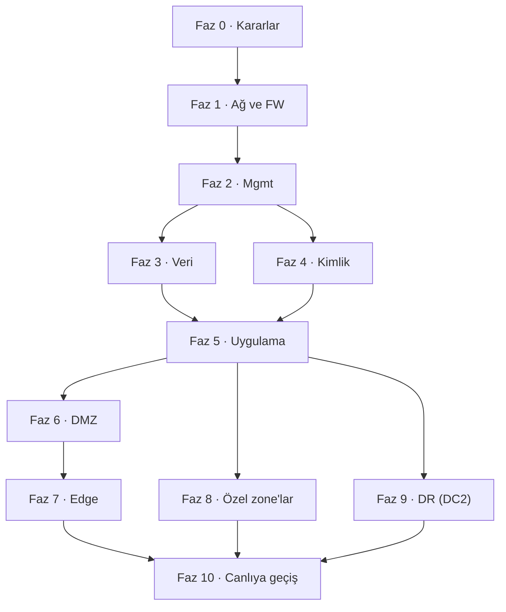
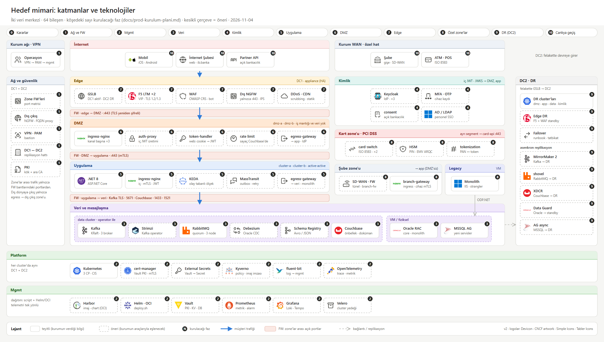

# Prod kurulum proje planı

Bu plan, [prod-detay](images/prod-detay/README.md) resimlerindeki hedef mimariyi 11 fazda (Faz 0–10)
kurar. Sıra içeriden dışarıyadır: mgmt → veri → kimlik → uygulama → DMZ → edge. Böylece her katman,
önündeki katman trafiğe açılmadan test edilmiş olur.

## Amaç ve kapsam

**Hedef:** İki veri merkezinde (DC1 ana, DC2 DR) çalışan, zone'lara ayrılmış, Kubernetes tabanlı
bankacılık platformu. Bu platform .NET mikroservisleri, legacy monolith'i ve veri katmanını taşır.

**Kapsamda:** ağ segmentasyonu ve FW, edge (F5/WAF/NGFW/GSLB), DMZ, uygulama, data, kimlik, şube,
kart (PCI), legacy, mgmt ve dış çıkış zone'ları, DR replikasyonu, uçtan uca doğrulama.

**Kapsam dışında:** .NET servislerinin kendi geliştirmesi, core banking değişiklikleri, kanal
uygulamaları (mobil/web istemci).

**Teyitli bilgiler (kurum):**

- DC1'de cluster-a ve cluster-b (active-active), DC2'de (DR) tek cluster
- Cluster'lar: DMZ (dmz-a / dmz-b), uygulama, data, mgmt. Girişler ingress-nginx.
- .NET mikroservisler. Legacy monolith'in bir kısmı VM'de (.NET Framework / IIS).
- Kafka, RabbitMQ ve Couchbase data cluster'ında. Oracle (core + monolith) ve MSSQL (yeni servisler) VM'de.
- Kanallar: mobil, web ve partner internetten gelir. Şube kurum WAN'ından, ATM/POS özel hattan gelir.

**Öneri olanlar:** F5, Strimzi, Keycloak, Vault, Harbor, MassTransit, Velero, servis adları, replika
sayıları, RPO/RTO değerleri. Faz 0'da kurumun araçlarıyla eşlenir.

**Kurulum yaklaşımı:** Dağıtım Git/GitOps ile değil, mgmt cluster'ından script + Helm chart'larıyla
yapılır. Chart ve imajlar OCI artefaktı olarak iç registry'de tutulur. Lab ortamındaki `up.sh` /
`verify.sh` mantığının prod sürümü kullanılır.

## Zone ve cluster envanteri

DC1'de 7 Kubernetes cluster'ı ve 4 VM/appliance zone'u var. DC2'de DR için 4 cluster ve yalnızca
toplayıcı rolünde bir mgmt bulunuyor. Her cluster'ın 3 control-plane'i olur.

| Zone | DC1 | DC2 (DR) | Platform | Başlıca bileşenler |
|---|---|---|---|---|
| Edge | F5 LTM ×2, WAF, dış NGFW, DDoS/CDN | F5 + WAF (standby) | Appliance | GSLB, kanal başına VIP |
| DMZ | dmz-a, dmz-b | dmz-dr | Kubernetes | Kanal başına ingress-nginx, auth-proxy, token-handler, ratelimit, egress |
| Uygulama | cluster-a, cluster-b | cluster-dr | Kubernetes | 14 namespace, .NET 8 servisleri, iç ingress (mTLS), egress-gateway |
| Data | data | data-dr | Kubernetes | Kafka, RabbitMQ, Couchbase (operator ile) |
| Veritabanı | Oracle RAC, MSSQL AG | Data Guard standby, AG async replika | VM / fiziksel | Core banking, monolith, yeni servisler |
| Kimlik | kimlik | kimlik-dr | Kubernetes | IdP, MFA/OTP, consent, directory (AD) |
| Şube | SD-WAN hub, branch-fw, branch-gateway | DR kopyası | Appliance + gateway | Cihaz sertifikası, şube kuralları |
| Kart (PCI) | atm-pos-fw, card-switch, HSM, tokenization | Şema hatları kopyası | Ayrı segment, cluster/VM | ISO 8583, EMV ARQC |
| Legacy | IIS VM'leri, NLB, batch VM | DR VM'leri | Windows Server VM | Strangler ile taşınan monolith |
| Mgmt | mgmt | mgmt-dr (toplayıcı + yedek) | Kubernetes | CI/CD, registry, Vault, gözlem, yedek |
| Dış çıkış | Outbound NGFW, forward proxy | Aynısı | Appliance | FQDN izin listesi, SIEM logu |

## Faz 0 — Kararlar ve önkoşullar

Kuruluma başlamadan önce aşağıdaki kararların kapanması gerekir. Ağ, PKI ve DNS kararları Faz 1'i,
K8s ve ingress kararları Faz 2'yi bloklar.

| Konu | Karar verilecek | Blokladığı faz |
|---|---|---|
| Ürün eşleme | Öneri ürünlerin (F5, Keycloak, Vault, Harbor, Strimzi, MassTransit, Velero) kurumun araçlarıyla eşlenmesi | 1–10 |
| K8s dağıtımı | RKE2 / OpenShift / kubeadm; tüm cluster'larda tek sürüm, CIS hardening | 2 |
| Ingress ürünü | ingress-nginx teyitli, ancak Mart 2026'da emekliye ayrıldı; Gateway API geçiş planı | 2 |
| IP / VLAN planı | DC1 ve DC2'de her zone için subnet; pod/service CIDR'ları çakışmasız | 1 |
| PKI | Kök CA ve ara CA'lar: dış TLS, iç mTLS, şube cihazı, partner (TPP) | 1 |
| DNS | GSLB zone'ları, iç `*.banka.local`, cluster başına wildcard | 1 |
| Kapasite | Replika tablosundan (00 resmi) worker sayısı ve donanım | 1 |
| PCI kapsamı | Kart zone'unun sınırı, QSA ile kapsam belgesi | 8 |
| RPO / RTO | Bileşen başına hedefler (07 resmindeki değerler öneri) | 9 |

**Çıkış kriteri:** Tüm kararlar yazılı ve onaylı; IP planı ve FW kural matrisi taslak olarak hazır.

## Sıra ve bağımlılıklar



Faz 0–2 sıralı ilerler. Faz 3 (veri) ile Faz 4 (kimlik) paralel yürür; ikisi de Faz 5'i bloklar.
Faz 5'ten sonra internet yolu (Faz 6 → 7), özel zone'lar (Faz 8) ve DR (Faz 9) paralel ilerler.
Üçü de bitmeden Faz 10 başlamaz. Süreler ve tarihler, başlangıç tarihi ve ekip dağılımı netleşince
eklenecek.

## Fazlar

Her faz bir çıkış kriteriyle kapanır. Bir sonraki faz, bu kriter sağlanmadan trafiğe açılmaz.

Her fazın kapanışında o fazın sonunu gösteren mimari resmi üretilir: `faz-NN-<faz>.png`. Bu resimde
kurulan bileşenler işaretlenir, ertelenenler yazılır. Adımlar:
[images/mimari/README.md](images/mimari/README.md#faz-bitiminde-yapılacaklar). Hedef mimari:

[](images/mimari/README.md)

### Faz 1 — Ağ ve güvenlik altyapısı

- [ ] DC1 ve DC2'de zone segmentlerini (VLAN/VRF) ve zone'lar arası FW'leri kur
- [ ] FW kural matrisini uygula; yalnızca gereken portlar açık olsun:
    - edge → DMZ ingress `:443`
    - DMZ → app ingress `:443`
    - app → data: Kafka TLS, RabbitMQ `5671`, Couchbase, MSSQL `1433`, Oracle `1521`
    - mgmt → tüm API server'lar `:6443`
    - tüm zone'lar → mgmt telemetri (tek yönlü)
- [ ] Dış çıkış zone'u: outbound NGFW, forward proxy (FQDN izin listesi), erişim logu → SIEM
- [ ] Kurum ağı erişimi: VPN → PAM → bastion
- [ ] DC1 ↔ DC2 replikasyon hattı (ayrı VLAN) ve kart şemaları için özel hat

**Çıkış kriteri:** `fw-test.sh` her zone'dan izinli portlara erişiyor, yasak portlara erişemiyor.

### Faz 2 — Mgmt cluster (bootstrap)

Diğer tüm cluster'lar buradan dağıtıldığı için ilk kurulan cluster mgmt'dir.

- [ ] K8s, ingress-nginx, cert-manager
- [ ] Registry (Harbor öneri): container, NuGet ve OS paket aynaları; dışarı yalnızca mgmt egress'i çıkar
- [ ] Vault: PKI engine (iç mTLS), KV, MSSQL/Oracle için dynamic secrets
- [ ] CI: .NET build → imaj ve Helm chart → registry (OCI)
- [ ] Deploy script'i: `deploy.sh <cluster> <release>`, mgmt'den hedef API'ye `helm upgrade --install oci://…`
- [ ] Gözlem: Prometheus, Grafana, Loki, Tempo; diğer cluster'larda yalnızca agent (fluent-bit, OTel)
- [ ] Yedek: Velero → nesne depolama

**Çıkış kriteri:** Boş bir test cluster'ına `deploy.sh` ile platform bileşenleri kuruluyor; loglar
ve metrikler mgmt'de görünüyor.

### Faz 3 — Veri katmanı

- [ ] Oracle RAC (core + monolith), DC2'ye Data Guard
- [ ] MSSQL Always On AG, DC2'ye asenkron replika; servis başına şema/login, TDE
- [ ] Data cluster: Kafka (Strimzi öneri, 3 broker, KRaft, TLS), Schema Registry, Debezium (Oracle CDC)
- [ ] RabbitMQ: cluster operator, 3 node, quorum queue
- [ ] Couchbase: operator; data, index ve query node'ları
- [ ] ingress-nginx: Kafka için TLS passthrough, RabbitMQ için TCP; Couchbase için pod başına LB

**Çıkış kriteri:** App segmentinden tüm veri servislerine bağlantı testi geçiyor.

### Faz 4 — Kimlik zone'u

- [ ] `iam`: IdP ×3 (Keycloak öneri), token exchange, JWKS
- [ ] `mfa`: OTP servisi, cihaz kaydı (mobil)
- [ ] `consent`: açık bankacılık onayı
- [ ] `directory`: AD/LDAP bağlayıcısı, personel SSO
- [ ] `egress`: SMS/OTP sağlayıcısına çıkış

**Çıkış kriteri:** İç JWT üretiliyor; JWKS'e DMZ'den ve app'ten erişilebiliyor.

### Faz 5 — Uygulama cluster'ları (cluster-a / cluster-b)

- [ ] Platform: cert-manager, external-secrets (Vault), Kyverno, KEDA, fluent-bit
- [ ] Varsayılan güvenlik: default-deny NetworkPolicy, `restricted` Pod Security, yalnızca registry'den gelen imzalı imajlar
- [ ] İç ingress-nginx: mTLS, yalnızca DMZ ve şube CIDR'ları, iç JWT doğrulama
- [ ] egress-gateway: veri, DB, monolith ve dış çıkış için tek çıkış noktası
- [ ] Servis namespace'leri: `channel-bff`, `account`, `customer`, `card`, `transfer`, `payment`, `loan`, `notification`, `fraud`, `integration`, `legacy-modules`
- [ ] Her servis için probe, HPA, PDB; outbox + relay deseni (04 resmi)
- [ ] İki cluster aynı chart ve imajla kurulur, yalnızca values dosyası farklıdır

**Çıkış kriteri:** Her iki cluster'da servisler sağlıklı; iç ingress üzerinden sentetik istek MSSQL,
Kafka ve RabbitMQ'ya ulaşıyor.

### Faz 6 — DMZ (dmz-a / dmz-b)

- [ ] Kanal başına ingress-nginx: mobile, web, partner (partner'da TPP mTLS ve kota)
- [ ] `auth`: auth-proxy, token-handler (web: cookie → iç JWT)
- [ ] `ratelimit`: sayacı Couchbase'de tutan rate limit
- [ ] `egress`: yalnızca app, IdP ve dış çıkış
- [ ] App upstream'leri: VIP veya selector'suz Service + EndpointSlice; DMZ'de iş mantığı ve veri yok

**Çıkış kriteri:** DMZ → app yolu her iki DMZ cluster'ından çalışıyor; biri düştüğünde trafik diğerine geçiyor.

### Faz 7 — Edge

- [ ] F5 LTM HA çifti, kanal başına VIP, TLS 1.2/1.3, HSTS
- [ ] WAF: OWASP CRS, bot koruması, API şema doğrulama
- [ ] Dış NGFW (yalnızca `:443`, IPS), DDoS/CDN
- [ ] GSLB: normalde DC1, DC1 düşerse DC2; sağlık kontrollü
- [ ] TLS F5'te sonlandırılır, DMZ'ye yeniden şifrelenerek gider

**Çıkış kriteri:** İnternet → edge → DMZ → app yolu sentetik testten geçiyor (henüz kamuya açık değil).

### Faz 8 — Özel zone'lar

- [ ] Şube: SD-WAN hub, branch-fw (HA), branch-gateway (ingress-nginx, cihaz sertifikası); DMZ'ye girmeden app ingress'ine
- [ ] Kart (PCI): atm-pos-fw, card-switch ×2 (ISO 8583), ağ HSM (HA), tokenization ×2; dışarı yalnızca `card-api :443` (mTLS + token)
- [ ] Legacy: IIS VM'leri + NLB; app ingress'inde strangler yönlendirmesi (`/*` → monolith, taşınan path'ler → cluster), ACL, Oracle CDC

**Çıkış kriteri:** Şube, ATM/POS ve monolith yolları uçtan uca çalışıyor; PCI kapsamı QSA tarafından kabul ediliyor.

### Faz 9 — DR (DC2)

- [ ] Aynı chart'lar DR values'larıyla kurulur (düşük replika, HPA ile büyür)
- [ ] Replikasyonlar: Kafka MirrorMaker 2, RabbitMQ shovel/federation, Couchbase XDCR, Oracle Data Guard, MSSQL AG async
- [ ] Failover runbook'u (07 resmi): veri → kimlik → app → DMZ → GSLB
- [ ] DR tatbikatı; RPO ve RTO ölçümü

**Çıkış kriteri:** Tatbikatta ölçülen RPO/RTO, Faz 0'da onaylanan hedeflerin içinde.

### Faz 10 — Doğrulama ve canlıya geçiş

- [ ] Uçtan uca senaryoları (09–14 resimleri) otomatik test olarak yaz: mobil transfer, web fatura, şube havale, partner hesap, POS, ATM
- [ ] Arıza testleri: dmz-a, cluster-a ve bir broker düşürülür
- [ ] Yük testi, pentest, PCI DSS denetimi
- [ ] Kanalları kademeli aç: partner ve web pilotu → mobil → şube → kart

**Çıkış kriteri:** Tüm senaryolar ve arıza testleri geçiyor; güvenlik ve PCI bulguları kapandı;
canlıya geçiş onayı alındı.

## Riskler ve açık konular

| Risk | Etki | Önlem |
|---|---|---|
| ingress-nginx Mart 2026'da emekliye ayrıldı, yeni güvenlik yaması yok | Tüm girişlerde yamasız açık riski | Faz 0'da Gateway API tabanlı alternatif seç; geçişi ayrı iş paketi olarak planla |
| Öneri ürünlerin kurum araçlarıyla eşlenmesi gecikir | Faz 2 ve sonrası başlayamaz | Eşleme kararını Faz 0 çıkış kriterine bağla |
| FW kural matrisi eksik veya fazla açık | Zone izolasyonu bozulur, denetim bulgusu çıkar | `fw-test.sh` ile her değişiklikte otomatik doğrulama |
| PCI kapsamı genişler | Denetim yükü ve süre artar | Kart zone'unu ayrı segmentte tut; dışarı yalnızca tokenize veri çıksın |
| DR replikasyonu ilk tatbikatta hedefi tutturamaz | RPO/RTO ihlali | Tatbikatı canlıya geçişten önce en az bir kez tekrarla |
| Lab ile prod arasındaki fark (tek node, L3 segmentasyon) | Lab'da geçen test prod'da kalabilir | Prod'a özgü testleri (port bazlı FW, HA) Faz 1 ve Faz 10'da ayrıca koştur |

**Açık sorular:**

- [ ] K8s dağıtımı hangisi olacak (RKE2 / OpenShift / kubeadm)?
- [ ] Kart zone'u ayrı bir Kubernetes cluster'ı mı olacak, VM mi?
- [ ] Mgmt-dr tam bir mgmt mi olacak, yalnızca toplayıcı ve yedek mi?
- [ ] Başlangıç tarihi ve ekip/sorumlu dağılımı nedir?

## Teslimatlar ve repo yapısı

Kurulum, inter-labs reposunun prod uzantısı olarak tutulur. Lab'daki script + Helm düzeni korunur.

```
envs/prod/<dc>/<cluster>/values-*.yaml   cluster başına Helm values
charts/                                  .NET servisleri için tek generic chart
platform/<bileşen>/                      ingress-nginx, cert-manager, kyverno, ...
scripts/prod/deploy.sh                   mgmt'den helm upgrade --install oci://...
scripts/prod/verify.sh                   uçtan uca senaryolar (09–14)
scripts/prod/fw-test.sh                  zone'lar arası port matrisi testi
docs/runbooks/                           failover, sertifika yenileme, yedekten dönüş
```

| Faz | Teslimat |
|---|---|
| 0 | Karar kaydı, IP planı, FW kural matrisi, PKI tasarımı |
| 1 | Kurulmuş segmentler, `fw-test.sh` raporu |
| 2 | Çalışan mgmt, `deploy.sh`, registry'de platform chart'ları |
| 3–8 | Zone başına values dosyaları, zone çıkış kriteri test raporu |
| 9 | Failover runbook'u, tatbikat raporu (ölçülen RPO/RTO) |
| 10 | `verify.sh` sonuçları, pentest ve PCI raporları, canlıya geçiş onayı |
| her faz | Faz sonu mimari resmi: `docs/images/mimari/faz-NN-<faz>.png` |

**Referans resimler** ([images/prod-detay](images/prod-detay/README.md)): 00 genel bakış · 01 giriş ·
02 DMZ · 03 uygulama · 04 .NET pod · 05 legacy · 06 veri · 07 DR · 08 mgmt · 09–14 uçtan uca
senaryolar · 15 şube · 16 kimlik · 17 kart (PCI).
